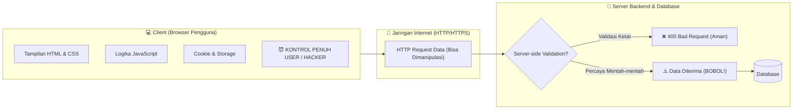

# 🛠️ Panduan Lengkap Browser DevTools untuk Web Exploitation & Pentesting

> Dokumen ini dirancang sebagai modul referensi terstruktur, berbasis poin (*modular*), dan dapat dikembangkan secara berkelanjutan seiring bertambahnya materi praktik.

---

## 📌 DAFTAR ISI
1. [Filosofi Keamanan Web: Prinsip "Trust No Client"](#1-filosofi-keamanan-web-prinsip-trust-no-client)
2. [Peta 5 Tab Vital DevTools & Hubungan Antar Tab](#2-peta-5-tab-vital-devtools--hubungan-antar-tab)
3. [Tab 1: Elements (DOM Tampering & Form Manipulation)](#3-tab-1-elements-dom-tampering--form-manipulation)
4. [Tab 2: Console (JavaScript Injection & Memory Tampering)](#4-tab-2-console-javascript-injection--memory-tampering)
5. [Tab 3: Sources (Pusat Intelijen, Debugging, & Local Overrides)](#5-tab-3-sources-pusat-intelijen-debugging--local-overrides)
6. [Tab 4: Network (Trafik HTTP & Information Disclosure)](#6-tab-4-network-trafik-http--information-disclosure)
7. [Tab 5: Application / Storage (Manipulasi Sesi & Otorisasi)](#7-tab-5-application--storage-manipulasi-sesi--otorisasi)
8. [Analisis Dampak: Client-Side vs Server-Side](#8-analisis-dampak-client-side-vs-server-side)
9. [Cheatsheet Shortcut & Perintah Penting](#9-cheatsheet-shortcut--perintah-penting)
10. [Jembatan Menuju Fase 2: Kapan DevTools Harus Diganti Burp Suite?](#10-jembatan-menuju-fase-2-kapan-devtools-harus-diganti-burp-suite)

---

## 1. Filosofi Keamanan Web: Prinsip "Trust No Client"



### Poin Kunci Keamanan:
* **Client-Side Berada 100% di Kendali User**: Segala file HTML, CSS, JavaScript, cookie, dan penyimpanan lokal yang diunduh ke browser dapat dilihat, diubah, dihapus, atau dihentikan oleh pengguna.
* **Validasi Frontend Hanyalah UX (User Experience)**: Pembatasan di browser (seperti tombol abu-abu `disabled`, kolom `maxlength="10"`, atau pesan JavaScript *"Password kurang dari 8 karakter"*) dibuat agar pengguna awam tidak salah ketik, **bukan sistem pertahanan keamanan**.
* **Pertahanan Mutlak Ada di Server**: Server tidak boleh percaya apa pun yang dikirim dari browser tanpa memvalidasi ulang keasliannya di backend database.

---

## 2. Peta 5 Tab Vital DevTools & Hubungan Antar Tab

| Tab DevTools | Peran Utama | Analogi | Hubungan dengan Tab Lain |
| :--- | :--- | :--- | :--- |
| **Elements** | Membedah & mengubah tampilan HTML/DOM. | Kulit luar bangunan & saklar | Menghubungkan elemen ke kode JS via panel *Event Listeners* (menuju Sources). |
| **Console** | Eksekusi JavaScript langsung di memori aktif. | Remote control sistem | Memanipulasi variabel global yang didefinisikan di Sources. |
| **Sources** | Membedah arsitektur kode JS & Local Overrides. | Cetak biru & ruang mesin | Titik henti (*breakpoint*) membuka variabel privat ke Console. |
| **Network** | Memantau paket request & respon backend. | Gerbang tol & kurir data | Menemukan endpoint API yang dibaca di Sources / Console. |
| **Application**| Memodifikasi tiket sesi (`Cookie`, `LocalStorage`). | Dompet & kartu akses | Mengubah hak akses sebelum request dikirim via Network. |

---

## 3. Tab 1: Elements (DOM Tampering & Form Manipulation)

Tab Elements menampilkan pohon struktur HTML yang sedang aktif (*Document Object Model* / DOM).

### Poin Eksploitasi:
1. **Bypass Pembatas Form**:
   * Menghapus atribut `disabled` agar tombol yang terkunci dapat diklik.
   * Menghapus atribut `readonly` agar kolom teks yang dikunci bisa diisi.
   * Mengubah atau menghapus `maxlength="5"` agar bisa mengirim teks panjang (misal payload SQLi/XSS).
2. **Unmasking Password**:
   * Mengubah atribut `<input type="password">` menjadi `<input type="text">`.
   * Teks password yang tertutup bintang/bulatan hitam langsung terbaca polos di layar.
3. **Hidden Parameter Tampering (Privilege Escalation)**:
   * Mengubah nilai form tersembunyi, contoh:
     ```html
     <!-- SEBELUM: -->
     <input type="hidden" name="role" value="guest_trainee">
     <!-- DIUBAH MENJADI: -->
     <input type="hidden" name="role" value="super_admin">
     ```
4. **Inspeksi Event Listener**:
   * Klik elemen apa saja $\rightarrow$ lihat panel samping **Event Listeners** $\rightarrow$ klik event `click` untuk langsung melihat kode JavaScript mana yang bekerja saat elemen tersebut disentuh.

---

## 4. Tab 2: Console (JavaScript Injection & Memory Tampering)

Tab Console adalah lingkungan interaktif REPL (*Read-Eval-Print Loop*) untuk mengeksekusi JavaScript di konteks halaman yang sedang aktif.

### Poin Eksploitasi:
1. **Memory Tampering (Mengubah Variabel Global)**:
   * Memanipulasi flag status keamanan yang disimpan di memori browser:
     ```javascript
     window.isUserLoggedIn = true;
     window.currentUserRole = "administrator";
     ```
2. **Pemicu Fungsi Tersembunyi (Triggering Hidden Functions)**:
   * Developer sering membuat fungsi bantuan/darurat yang lupa dihapus saat produksi:
     ```javascript
     window.emergencyBypassAccess();
     unlockAdminDashboard();
     ```
3. **Catatan Khusus: Waspadai Overwrite Objek (Pelajaran Penting Kasus Nyata)**:
   > [!WARNING]
   > Jangan menimpa variabel bertipe **Object** dengan nilai primitif **Boolean**!
   > * **Salah**: Mengetik `window.vaultSecurity = true` akan merusak objek sehingga properti dalamnya hilang.
   > * **Benar**: Ubah properti spesifiknya: `window.vaultSecurity.isVerified = true` atau pulihkan seluruh objeknya: `window.vaultSecurity = { isVerified: true }`.

---

## 5. Tab 3: Sources (Pusat Intelijen, Debugging, & Local Overrides)

Tab Sources adalah IDE dan debugger terintegrasi di dalam browser.

### Poin Fitur & Eksploitasi:
1. **Pretty Print (`{ }`)**:
   * File JavaScript di website produksi biasanya di-*minify* (dipadatkan tanpa spasi menjadi 1 baris).
   * Klik ikon kurung kurawal **`{ }`** di baris bawah untuk merapikan kembali ribuan baris kode agar mudah dibaca manusia.
2. **Global Code Search (`Ctrl + Shift + F`)**:
   * Memungkinkan pencarian teks di seluruh file website sekaligus.
   * Kata kunci pencarian favorit pentester:
     * `"apiKey"`, `"secret"`, `"auth_token"`, `"Bearer"`
     * `"/api/v1/admin"`, `"/debug"`, `"/internal"`
     * `"password"`, `"jwt"`, `"firebaseConfig"`
3. **Breakpoints (Menghentikan Eksekusi Kode)**:
   * Klik nomor baris kode di tab Sources. 
   * Saat fungsi berjalan dan menyentuh baris tersebut, browser akan berhenti (*paused*).
   * Di saat jeda ini, tab **Console dapat mengakses semua variabel lokal/privat** di dalam fungsi tersebut.
4. **Local Overrides (Bypass Permanen di Browser)**:
   * **Konsep**: Mengizinkan browser membaca file hasil modifikasi dari folder laptop kita alih-alih mengambil file asli dari server.
   * **Alur Aktivasi**:
     1. Tab Sources $\rightarrow$ Sub-tab **Overrides**.
     2. Klik **`+ Select folder for overrides`** $\rightarrow$ Pilih folder di laptop $\rightarrow$ Klik **Allow**.
     3. Centang **`[✓] Local overrides`**.
     4. Buka file `.js` / `.html`, edit sesuka hati, lalu simpan (**`Ctrl + S`**). Muncul titik ungu `🟣`.
     5. Tekan **`F5`** $\rightarrow$ Hasil editan aktif permanen meski halaman di-refresh berkali-kali.

---

## 6. Tab 4: Network (Trafik HTTP & Information Disclosure)

Tab Network memantau seluruh komunikasi bolak-balik antara browser dan server secara *real-time*.

### Poin Eksploitasi:
1. **Mendeteksi Background Request (AJAX / Fetch / XHR)**:
   * Filter request dengan mengklik tombol **Fetch/XHR**.
   * Menemukan URL endpoint API rahasia yang tidak tampak di alamat bar browser (misal: `/api/internal/users/10842`).
2. **Information Disclosure (Kebocoran Objek Sensitif)**:
   * Sering kali developer backend mengirimkan seluruh baris database dalam format JSON, padahal tampilan frontend hanya menampilkan nama dan foto profil.
   * Klik salah satu request $\rightarrow$ buka sub-tab **Response** atau **Preview** $\rightarrow$ cari field data bocor seperti:
     ```json
     {
       "public_profile": { "name": "Budi", "role": "Staff" },
       "_internal_data": { 
         "admin_pin": "PIN-99281-SUPERSECRET", 
         "db_user": "db_admin_root" 
       }
     }
     ```
3. **Menganalisis Parameter Request**:
   * Di sub-tab **Payload / Headers**, lihat data apa yang dikirim saat mengklik tombol form atau checkout.

---

## 7. Tab 5: Application / Storage (Manipulasi Sesi & Otorisasi)

Tab Application adalah tempat penyimpanan data jangka panjang yang disimpan di sisi browser klien.

### Poin Eksploitasi:
1. **Cookies**:
   * Token sesi sering disimpan di sini.
   * **Eksploitasi**: Mengubah nilai cookie penentu hak akses, contoh: `auth_role=guest` $\rightarrow$ diubah menjadi `auth_role=admin`.
   * **Atribut Keamanan Cookie**:
     * `HttpOnly`: Mencegah JavaScript/XSS membaca cookie via `document.cookie`.
     * `Secure`: Memaksa cookie hanya dikirim lewat jalur HTTPS.
     * `SameSite`: Mencegah serangan CSRF (*Strict / Lax / None*).
2. **LocalStorage & SessionStorage**:
   * Digunakan oleh aplikasi web modern (React, Vue, SPA) untuk menyimpan token JWT (*JSON Web Token*).
   * **Eksploitasi**: Mengubah kunci privilege, misalnya mengubah `user_privilege="free"` menjadi `"god_mode"` atau `"vip"`.

---

## 8. Analisis Dampak: Client-Side vs Server-Side

> [!NOTE]
> *"Jika saya mengoprek semua kode di browser, apa dampaknya bagi server?"*

### Komparasi Efek:

| Skenario | Dampak pada Laptop Kamu | Dampak pada Server / User Lain |
| :--- | :--- | :--- |
| **Mengedit HTML / CSS / JS** | Tampilan berubah, tombol aktif, logika jalan sesuai editanmu. | **Nol / Tidak ada efek sama sekali**. |
| **Kodenya Dihapus Semua / Error**| Halaman crash, blank putih, tombol mogok. | **Tetap normal**. Kembalikan dengan uncheck Local Overrides + Refresh. |
| **Mengirim Data Ilegal ke Server** | Browser mengirim payload hasil oprekan lewat HTTP Request. | **Tergantung Validasi Server**: <br>• Jika server ketat $\rightarrow$ Ditolak (Aman).<br>• Jika server ceroboh $\rightarrow$ Database tertipu (BOBOL!). |

---

## 9. Cheatsheet Shortcut & Perintah Penting

### ⌨️ Shortcut Keyboard:
* **`F12`** atau **`Ctrl + Shift + I`**: Buka/Tutup DevTools.
* **`Ctrl + Shift + C`**: Inspect Element langsung (arahkan mouse ke elemen).
* **`Ctrl + Shift + F`**: Global Search di seluruh file (Tab Sources).
* **`Ctrl + F`**: Cari teks di dalam file yang sedang aktif.
* **`Ctrl + S`**: Simpan modifikasi file (Local Overrides).
* **`Ctrl + R`** atau **`F5`**: Refresh halaman.

### 💻 Snippet Console Cepat:
```javascript
// 1. Mengintip semua nilai cookie aktif
console.log(document.cookie);

// 2. Mengintip seluruh isi LocalStorage
console.table(localStorage);

// 3. Mengubah tipe semua input password di halaman menjadi teks polos
document.querySelectorAll('input[type="password"]').forEach(el => el.type = 'text');

// 4. Mengaktifkan semua tombol yang disabled di halaman
document.querySelectorAll('button[disabled]').forEach(el => el.removeAttribute('disabled'));
```

---

## 10. Jembatan Menuju Fase 2: Kapan DevTools Harus Diganti Burp Suite?

Meskipun DevTools sangat hebat, ada batas kemampuan teknis di mana seorang pentester **harus menggunakan Web Proxy (Burp Suite)**:

| Kebutuhan Analisis | Browser DevTools | Burp Suite (Fase 2) |
| :--- | :---: | :---: |
| Mengedit DOM, HTML, dan CSS | ✅ Sangat Cepat | ❌ Rumit |
| Menjalankan fungsi JavaScript internal | ✅ Ya (Console) | ❌ Tidak bisa |
| Mencegat paket HTTP mentah sebelum terkirim | ❌ Terbatas | ✅ Intercept Presisi |
| Mengirim ulang paket 100x dengan modifikasi cepat | ❌ Harus klik manual | ✅ Burp Repeater (`Ctrl + R`) |
| Brute force & Fuzzing ribuan variasi kata sandi | ❌ Sangat lambat | ✅ Burp Intruder |
| Memanipulasi HTTP Request Headers mentah | ❌ Terbatas | ✅ Bebas sepenuhnya |

---

*Disusun untuk Pembelajaran Pilar 3: Web Exploitation — Fase 1 (DevTools Mastery).*
