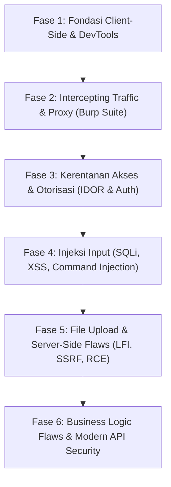

# 🛡️ Catatan Belajar & Roadmap Web Exploitation (Pilar 3)

Dokumen ini berisi rangkuman diskusi, roadmap terstruktur, penjelasan konsep Fase 1 & 2, serta kata kunci pencarian YouTube untuk belajar mandiri.

---

## 🗺️ Roadmap Utama Web Exploitation (Fase 1 - 6)

---

## 🧭 FASE 1: Fondasi Client-Side & Browser DevTools

Prinsip Utama: **"Trust No Client"** — Segala hal yang berjalan di browser pengguna dapat diubah, dihapus, atau dibypass oleh penyerang.

### 1. Arsitektur Web Client-Server

- **Client (Frontend)**: Tampilan visual di browser (HTML, CSS, JavaScript). Berada 100% di bawah kendali user.
- **Server (Backend & Database)**: Mesin pemroses logika bisnis dan penyimpanan data aman (PHP, Node.js, Python, MySQL, dll).
- **Pelajaran Keamanan**: Jangan pernah menaruh logika rahasia atau validasi tunggal di sisi client.

### 2. Anatomi Protokol HTTP / HTTPS

- **HTTP Request**:
  - **Method**: `GET` (ambil data via URL), `POST` (kirim data via request body), `PUT`/`DELETE` (modifikasi/hapus via API).
  - **Headers**: `User-Agent` (identitas browser), `Cookie` (sesi login), `Content-Type` (format data).
  - **Body**: Payload data yang dikirimkan.
- **HTTP Response**:
  - **Status Code**: `200 OK`, `301/302 Redirect`, `400 Bad Request`, `401 Unauthorized`, `403 Forbidden`, `404 Not Found`, `500 Internal Server Error` (tanda potensi celah injeksi backend).
  - **Headers**: `Set-Cookie`, `Access-Control-Allow-Origin`, `Content-Security-Policy`.

### 3. Eksplorasi 4 Tab Utama DevTools (`F12`)

- **Tab Elements**:
  - Menghapus atribut pembatas seperti `disabled`, `readonly`, `hidden`, `maxlength`.
  - Mengintip password: ubah `type="password"` $\rightarrow$ `type="text"`.
  - Memanipulasi parameter form tersembunyi (`<input type="hidden" name="harga">`).
- **Tab Console**:
  - Eksekusi JavaScript secara instan.
  - Memanggil fungsi tersembunyi (misal: `grantAccess()`, `debugMode = true`).
  - Mengecek variabel global yang membocorkan API Key atau token.
- **Tab Network**:
  - Merekam request AJAX/Fetch di latar belakang.
  - Memeriksa response JSON utuh dari server (mendeteksi data sensitif yang tidak ditampilkan di UI).
- **Tab Application / Storage**:
  - **Cookies**: Token sesi, flag keamanan `HttpOnly` (proteksi XSS), `Secure` (HTTPS only).
  - **LocalStorage & SessionStorage**: Tempat penyimpanan token JWT di aplikasi modern.

### 4. Client-Side Validation Bypass

- Validasi via HTML5 atau JavaScript hanya berfungsi untuk _User Experience (UX)_ agar user awam tidak salah ketik, bukan untuk keamanan!

---

## 🛰️ FASE 2: Intercepting Traffic & Proxy (Burp Suite)

Prinsip Utama: **Menangkap dan memanipulasi paket HTTP mentah di jaringan sebelum sampai ke server.**

### 1. Konsep Man-In-The-Middle (MitM) Web Proxy

- Burp Suite bertindak sebagai perantara transparan di antara browser dan server target (`127.0.0.1:8080`).
- Alur: `Browser` $\rightarrow$ `Burp Suite (Intercept / Edit Paket)` $\rightarrow$ `Server`.

### 2. SSL/TLS & CA Certificate

- Mengimpor sertifikat root Burp (`cacert.der`) ke browser agar lalu lintas terenkripsi HTTPS bisa didekripsi dan dimanipulasi tanpa peringatan bahaya SSL.
- Atau menggunakan fitur **Embedded Browser** bawaan Burp Suite.

### 3. Burp Proxy: Parameter & Header Tampering

- **Parameter Tampering**: Mengubah nilai paket data mentah (contoh: ubah `qty=1` jadi `qty=-1`, atau ubah `user_id=5` jadi `user_id=1`).
- **Header Tampering**: Memalsukan header `X-Forwarded-For: 127.0.0.1` (bypass IP lokal) atau `User-Agent`.

### 4. Burp Repeater (Shortcut `Ctrl + R`)

- Mengirimkan request berulang kali secara instan tanpa perlu bolak-balik mengisi form di web.
- Tempat meracik payload SQL Injection, XSS, dan IDOR secara presisi.

### 5. Burp Intruder & Fuzzing Dasar

- Mengirim ratusan hingga ribuan payload secara otomatis ke posisi parameter tertentu.
- Sangat berguna untuk: Brute-force form login, fuzzing endpoint tersembunyi, fuzzing ID pengguna (IDOR).

### 6. Analisis HTTP History & Sitemap

- Merekam seluruh riwayat request dan menyusun pohon struktur direktori target.
- Mendeteksi endpoint tersembunyi, file backup (`.bak`, `.old`), dan kebocoran informasi (_Information Disclosure_).

---

## 📺 Kata Kunci Pencarian YouTube (Search Keywords)

### 1. DOM & Inspect Element

- 🇮🇩 _"Belajar Inspect Element untuk Pemula"_
- 🇮🇩 _"Trik Inspect Element melihat password"_
- 🇬🇧 _"Chrome DevTools for Web Pentesting"_
- 🇬🇧 _"Inspect Element Tricks for Hackers"_
- 🇬🇧 _"DOM Manipulation using DevTools"_

### 2. Client-Side Validation Bypass

- 🇮🇩 _"Bypass validasi form HTML JavaScript"_
- 🇮🇩 _"Client side vs Server side validation keamanan web"_
- 🇬🇧 _"Bypassing Client-Side Controls / Validation"_
- 🇬🇧 _"Bypass HTML5 Form Validation Web Security"_

### 3. Cookies & Browser Storage

- 🇮🇩 _"Belajar Cookie, LocalStorage, dan SessionStorage"_
- 🇮🇩 _"Cara kerja Cookie dan Session keamanan web"_
- 🇬🇧 _"Cookies, LocalStorage, SessionStorage Explained for Hackers"_
- 🇬🇧 _"Cookie Security: HttpOnly, Secure, SameSite Explained"_

### 4. Protokol HTTP/HTTPS

- 🇮🇩 _"Cara kerja protokol HTTP dan HTTPS"_
- 🇮🇩 _"Memahami HTTP Request dan Response"_
- 🇬🇧 _"How the Web Works for Cybersecurity"_
- 🇬🇧 _"HTTP Crash Course for Web Penetration Testing"_

### 5. Rekomendasi Channel YouTube

1. **Web Programming UNPAS** (Indonesia - Konsep Dasar Web, HTTP, Cookie & Session).
2. **NetworkChuck** (Inggris - Visualisasi seru: HTTP, SSL/TLS, Cookies).
3. **The Cyber Mentor / TCM Security** (Inggris - Practical Ethical Hacking Web Basics).
4. **InsiderPhD** (Inggris - Web App Security for Beginners).
5. **NahamSec** (Inggris - Bug Bounty & Web Recon).

---

## 📂 File Praktik Tersedia di Workspace Ini

1. [01_latihan_inspect.html](file:///d:/Cybersecurity_Labs/pilar3_web_exploit/01_latihan_inspect.html) - Lab 01: Bypass tombol disabled, unmasking password, dan price tampering via hidden input.
2. [02_lab_devtools_mastery.html](file:///d:/Cybersecurity_Labs/pilar3_web_exploit/02_lab_devtools_mastery.html) - Lab 02: Eksploitasi 4 Tab Vital DevTools (**Elements**, **Console**, **Application/Cookie**, **Network API Leak**).
3. [03_lab_ctf_devtools_medium.html](file:///d:/Cybersecurity_Labs/pilar3_web_exploit/03_lab_ctf_devtools_medium.html) - Lab 03: **CTF DevTools Medium (5 Tab)**: Tantangan CTF tingkat sedang mencakup 5 tab vital DevTools (**Elements**, **Console**, **Sources**, **Network**, **Application**) dilengkapi sistem scoreboard dan verifikasi flag.
4. [challenge_sources_vault.js](file:///d:/Cybersecurity_Labs/pilar3_web_exploit/challenge_sources_vault.js) - Skrip eksternal untuk tantangan breakpoint di Tab Sources.
5. [api_telemetry_report.json](file:///d:/Cybersecurity_Labs/pilar3_web_exploit/api_telemetry_report.json) & [api_stage2_privilege.json](file:///d:/Cybersecurity_Labs/pilar3_web_exploit/api_stage2_privilege.json) - Mock API bertingkat untuk tantangan Tab Network.
6. [PANDUAN_SOLUSI_CTF_DEVTOOLS_SEDANG.md](file:///d:/Cybersecurity_Labs/pilar3_web_exploit/PANDUAN_SOLUSI_CTF_DEVTOOLS_SEDANG.md) - Panduan solusi, writeup langkah demi langkah, dan mitigasi backend untuk Lab 03.
7. [api_user_data.json](file:///d:/Cybersecurity_Labs/pilar3_web_exploit/api_user_data.json) - Mock API endpoint yang membocorkan rahasia backend untuk Lab 02.
8. [PANDUAN_LENGKAP_DEVTOOLS_EXPLOIT.md](file:///d:/Cybersecurity_Labs/pilar3_web_exploit/PANDUAN_LENGKAP_DEVTOOLS_EXPLOIT.md) - Modul referensi lengkap, terstruktur, berbasis poin (Elements, Console, Sources & Overrides, Network, Application, dan Cheatsheet).
